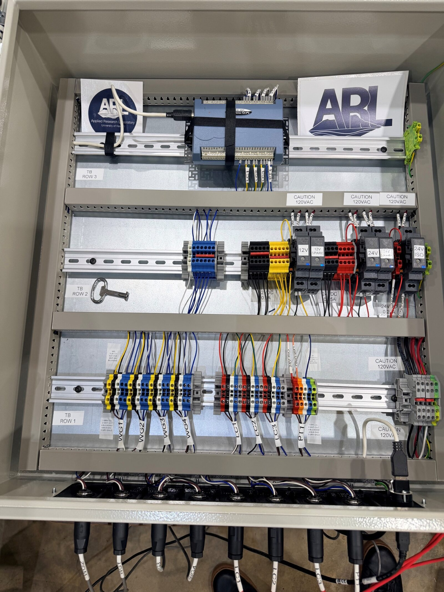

# Wave Flume DAQ Panel

<p align="center">
  
</p>

DAQ panel for a laboratory wave flume: 4× Akamina AWP-24-3 wave-height
gauges, 3× FUTEK LSB210 load cells (through IAA100 amplifiers at the flume), and a Setra 239
differential pressure transducer - all eight channels **differential** into an MCC **USB-1608G**
(16-bit), with three isolated power islands and M12 bulkhead connectors on a DIN-rail panel.

## Documentation site

The full **Interface Control Document** - every pinout, cable, terminal map, and the grounding
rationale - is live at:

### 📖 <https://arl-at-uh.github.io/Wave_Flume_DAQ/>

GitHub Pages serves [`docs/index.html`](docs/index.html) directly - one self-contained page,
no build step - and redeploys automatically on every push to `main`. Step-by-step bench
procedures live in [`docs/procedures/`](docs/procedures/) and debugging guides in
[`docs/debug/`](docs/debug/).

## Schematic

<!-- Re-enable once docs/schematic.svg + schematic-dark.svg are exported (kicad-cli currently broken):
<picture>
  <source media="(prefers-color-scheme: dark)" srcset="docs/schematic-dark.svg">
  
</picture>
-->
*Printable copy: [`docs/wave_flume_daq_schematic.pdf`](docs/wave_flume_daq_schematic.pdf)
(A2 sheet - print poster-tiled at 100% or large-format).*

**Interactive viewer:** [open the schematic in KiCanvas](https://kicanvas.org/?github=https://github.com/ARL-at-UH/Wave_Flume_DAQ/blob/main/kicad_schematic/wave_flume_daq.kicad_sch) -
pan, zoom, and click nets in the browser, nothing to install. Or paste this link into
[kicanvas.org](https://kicanvas.org) yourself:

```text
https://github.com/ARL-at-UH/Wave_Flume_DAQ/blob/main/kicad_schematic/wave_flume_daq.kicad_sch
```

## Repo map

| Path | Contents |
|---|---|
| [`docs/`](docs/) | Hosted ICD (`index.html`), step-by-step [`procedures/`](docs/procedures/), [`debug/`](docs/debug/) guides, schematic PDF, as-ordered BOM |
| [`ref/`](ref/) | Primary sources: sensor/DAQ manufacturer manuals and drawings (indexed in its README) |
| [`kicad_schematic/`](kicad_schematic/) | KiCad 9/10 project - schematic, project symbol library |


## cite
